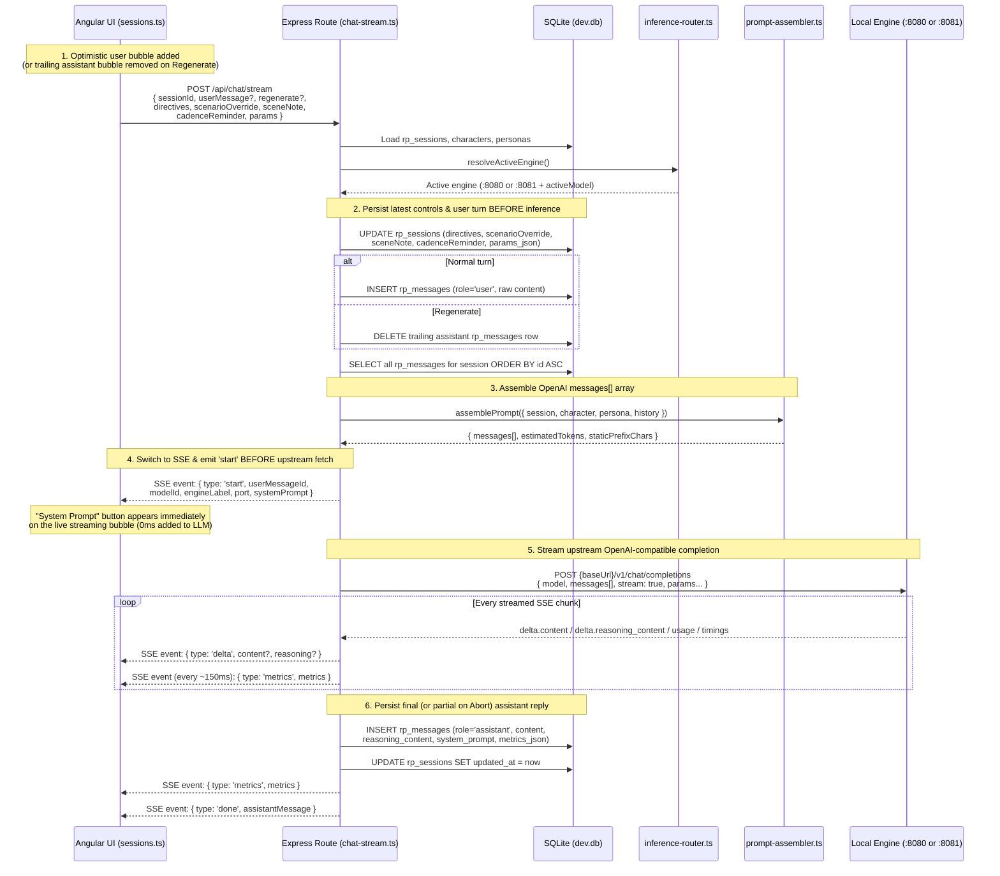

# Kron Virtual — Session Flow, Prompt Assembly & UI Variable Map

> **Purpose**: Complete technical walkthrough of what happens on every roleplay turn in Kron Virtual — covering exact execution timing, how `prompt-assembler.ts` constructs the OpenAI-compatible `messages[]` payload, and where every single assembly/sampler variable is controlled in the UI.

---

## 1. End-to-End Turn Timing & Execution Flow

When you click **Send** (or press `Enter`) or click **Regenerate** in the Sessions view, the turn executes in the following exact sequence:



### Key Timing Guarantees
1. **Zero Inference Overhead for System Prompt Inspection**: `sendSse(res, { type: 'start', ..., systemPrompt })` writes synchronously to the response stream **immediately before** `await fetch('{baseUrl}/v1/chat/completions')` is called. The frontend receives the exact assembled system prompt while the LLM is still running prompt prefill (TTFT).
2. **Controls Auto-Persist on Every Turn**: Any edits you made to `directives`, `scenarioOverride`, `sceneNote`, `cadenceReminder`, or `params` in the UI are sent along with `POST /api/chat/stream` and saved to `rp_sessions` before `assemblePrompt()` runs — even if you didn't click **Save Controls**.
3. **Raw Text in SQLite, XML Tags Only in Flight**: Your user message is stored in `rp_messages.content` as plain RP text. Depth-1 `<scene_note>` and `<cadence_reminder>` wrappers are **never** written into `rp_messages`; they are injected ephemerally by `prompt-assembler.ts` only when building the outbound `messages[]` array.
4. **Automatic Fallback on Strict Servers**: `chat-stream.ts` first sends `stream_options: { include_usage: true }` plus extended samplers (`min_p`, `dry_*`). If the upstream server returns HTTP `400` or `422`, it immediately retries with a minimal standard OpenAI payload (`model`, `messages`, `stream`, `temperature`, `top_p`, `max_tokens`).
5. **Clean Abort & Partial Save**: Clicking **Stop** aborts the browser `fetch` via `AbortController`, which triggers `res.on('close')` on Express and aborts the upstream LLM request immediately. Whatever tokens were already generated are still persisted to `rp_messages` and reloaded cleanly.

---

## 2. How `prompt-assembler.ts` Builds `messages[]`

Implemented in [`backend/src/services/prompt-assembler.ts`](./backend/src/services/prompt-assembler.ts), the assembler follows the KV-cache and anti-drift rules in [`technical-guide.md`](./technical-guide.md).

### Step A — Placeholder Substitution
Every static and dynamic template string runs through `replacePlaceholders(text, charName, userName)`:
- `{{char}}` (case-insensitive) → `character.name`
- `{{user}}` (case-insensitive) → `persona.name`

### Step B — Index `0`: Single Static System Message (`buildStaticSystemPrompt`)
All immutable session context is concatenated with blank lines into **one** `role: "system"` message at `messages[0]`. Empty optional sections are omitted cleanly:

```text
<directives>
{session.directives}
</directives>

<character name="{character.name}">
{character.description}

Personality: {character.personality}

Speech & Style: {character.speechPatterns}
</character>

<user_persona name="{persona.name}">
{persona.description}

Background: {persona.background}
</user_persona>

<scenario>
{session.scenarioOverride || character.scenario}
</scenario>

<example_dialogue>
{character.exampleDialogue}
</example_dialogue>
```

> **Why single leading system message?** Local inference engines (`llama.cpp`, vLLM, SGLang) prefix-cache the KV state from token `0` onward. Keeping index `0` immutable across turns preserves prefix KV-caching, and avoiding mid-thread `system` messages prevents Jinja chat-template errors on strict models (Mistral, Gemma, Llama/DeepSeek variants).

### Step C — Indices `1..N`: Persisted Conversation History
Every row in `rp_messages` for the session (ordered by `id ASC`) is appended verbatim as `{ role: 'user' | 'assistant', content }`.
- When a new session is created and the Character has a `firstMessage`, that greeting is seeded as `messages[1]` with `role: 'assistant'`.
- When you **Edit** a message in the UI (`PATCH /api/messages/:id`), the updated text is what gets read here on subsequent turns — immediately breaking autoregressive repetition loops.

### Step D — Depth-1 Inline Dynamic Injection
If `session.sceneNote` and/or `session.cadenceReminder` are non-empty, `assemblePrompt()` finds the **last `role: 'user'` message** in `messages[]` and prepends the XML blocks inline at the top of that user turn:

```text
<scene_note>
{session.sceneNote}
</scene_note>

<cadence_reminder>
{session.cadenceReminder}
</cadence_reminder>

{original user message text}
```

Because this is placed right at the tail of the prompt (Depth 1), it sits in the model's high-attention recency window without invalidating the KV cache of the static system prompt or earlier turns.

---

## 3. Complete Variable-to-UI Control Map

> **Where are the session variables in the UI?**
> In the **Sessions** view (`/sessions`), look at the top toolbar next to the `Character × Persona` badge and click the **`Scene & Samplers`** button. That drawer is **collapsed by default** to keep the chat transcript clean, and it contains all four session-level prompt variables (`sceneNote`, `cadenceReminder`, `directives`, `scenarioOverride`) plus all five sampler controls.
>
> Next to it is the **`Prompt Inspector`** button, which calls `GET /api/sessions/:id/prompt-preview` to show the entire assembled `messages[]` array at any time.

### 3.1 Session-Level Prompt Variables (`rp_sessions`)

| Backend / Request Variable | SQLite Column (`rp_sessions`) | Where to Control in UI | UI Label & Signal (`sessions.ts`) | Prompt Position & XML Tag | KV-Cache Impact |
| :--- | :--- | :--- | :--- | :--- | :--- |
| `body.directives` / `sessionRow.directives` | `directives` | **Sessions** → Toolbar → **`Scene & Samplers`** button | **Directives (Index 0 — Static Cached Prefix)** (`directives`) | `messages[0]` → `<directives>` | **Static** (changing it invalidates prefix cache) |
| `body.scenarioOverride` / `sessionRow.scenarioOverride` | `scenario_override` | **Sessions** → Toolbar → **`Scene & Samplers`** button | **Scenario Override (Index 0 — Optional)** (`scenarioOverride`) | `messages[0]` → `<scenario>` (overrides `character.scenario` if non-empty) | **Static** (changing it invalidates prefix cache) |
| `body.sceneNote` / `sessionRow.sceneNote` | `scene_note` | **Sessions** → Toolbar → **`Scene & Samplers`** button | **Scene Note (Depth 1 — Dynamic)** (`sceneNote`) | Prepended inline to **last `user` message** → `<scene_note>` | **Dynamic** (prefix stays cached) |
| `body.cadenceReminder` / `sessionRow.cadenceReminder` | `cadence_reminder` | **Sessions** → Toolbar → **`Scene & Samplers`** button | **Cadence Reminder (Depth 1 — Dynamic)** (`cadenceReminder`) | Prepended inline to **last `user` message** → `<cadence_reminder>` | **Dynamic** (prefix stays cached) |

*Default values*: On `POST /api/sessions`, `directives` is initialized from `DEFAULT_RP_DIRECTIVES` in [`backend/src/db/init.ts`](./backend/src/db/init.ts); `scenarioOverride`, `sceneNote`, and `cadenceReminder` start empty `""`.

### 3.2 Session-Level Sampler Parameters (`rp_sessions.params_json`)

All sampler parameters live in the bottom row of the **`Scene & Samplers`** drawer in **Sessions** (`/sessions`) and are sent in `body.params` on `POST /api/chat/stream`:

| Variable (`body.params.*`) | Default | UI Input Label (`sessions.ts` signal) | Sent to Upstream LLM |
| :--- | :--- | :--- | :--- |
| `temperature` | `0.85` | **Temperature** (`temperature`) | Always (clamped `0..2`) |
| `top_p` | `0.95` | **Top P** (`topP`) | Always (clamped `0..1`) |
| `min_p` | `0.05` | **Min P** (`minP`) | Extended payload (stripped on 400/422 fallback) |
| `max_tokens` | *(omitted)* | **Max Tokens** (`maxTokens`) | Only if positive integer |
| `dry_multiplier` | *(omitted)* | **DRY Mult (llama.cpp)** (`dryMultiplier`) | Extended payload if `> 0`; automatically pairs with `dry_base: 1.75` and `dry_allowed_length: 2` |

### 3.3 Character Variables (`characters` table)

Controlled in the **Characters** page (`/characters`, [`features/characters/characters.ts`](./frontend/src/app/features/characters/characters.ts)):

| Variable (`character.*`) | SQLite Column | UI Field Label | Prompt Position & Usage |
| :--- | :--- | :--- | :--- |
| `character.name` | `name` | **Name \*** | `<character name="...">` attribute + `{{char}}` substitution + chat bubble header |
| `character.tagline` | `tagline` | **Tagline** | UI list/dropdown display only (not sent to LLM) |
| `character.description` | `description` | **Description & Background** | `messages[0]` → inside `<character>` |
| `character.personality` | `personality` | **Personality & Flaws** | `messages[0]` → inside `<character>` as `Personality: ...` |
| `character.speechPatterns` | `speech_patterns` | **Speech Patterns & Style** | `messages[0]` → inside `<character>` as `Speech & Style: ...` |
| `character.scenario` | `scenario` | **Default Scenario** | `messages[0]` → `<scenario>` (used unless `session.scenarioOverride` is set) |
| `character.firstMessage` | `first_message` | **Opening Greeting (First Message)** | Seeded as initial `assistant` message when creating or resetting a session (not in `<system>`) |
| `character.exampleDialogue` | `example_dialogue` | **Example Dialogue (Few-Shot Voice Anchor)** | `messages[0]` → `<example_dialogue>` |

### 3.4 Persona Variables (`personas` table)

Controlled in the **Personas** page (`/personas`, [`features/personas/personas.ts`](./frontend/src/app/features/personas/personas.ts)):

| Variable (`persona.*`) | SQLite Column | UI Field Label | Prompt Position & Usage |
| :--- | :--- | :--- | :--- |
| `persona.name` | `name` | **Persona Name \*** | `<user_persona name="...">` attribute + `{{user}}` substitution + user bubble header |
| `persona.description` | `description` | **Appearance & Demeanor** | `messages[0]` → inside `<user_persona>` |
| `persona.background` | `background` | **Background & Key Facts** | `messages[0]` → inside `<user_persona>` as `Background: ...` |
| `persona.isDefault` | `is_default` | **Set as default persona** checkbox | Pre-selects this persona in the "Start a New Roleplay Session" form |

---

## 4. Inspecting Assembled Prompts Live

Kron Virtual provides two complementary ways to inspect what the assembler produces:

1. **Per-Reply `System Prompt` Modal** *(Zero-latency, turn-exact)*:
   - Appears immediately on the **live streaming bubble** (populated by the SSE `start` event before the LLM finishes prefill) and stays attached to every saved assistant reply (`rp_messages.system_prompt`).
   - Shows the exact index-0 `system` message used for that specific reply, with char/token count and a **Copy** button.
2. **`Prompt Inspector` Drawer** *(Full `messages[]` array)*:
   - Toggled from the **Sessions** toolbar (`Prompt Inspector` button).
   - Calls `GET /api/sessions/:id/prompt-preview` to show every message `[0] SYSTEM`, `[1] ASSISTANT`, `[2] USER`, etc., including how `<scene_note>` and `<cadence_reminder>` are injected into the latest user turn.
